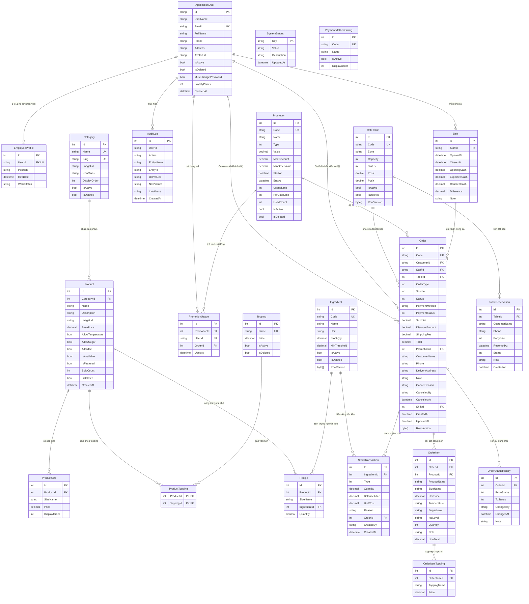

# Sơ Đồ Thực Thể Quan Hệ (ERD) – Đạt Mộc Coffee

Tài liệu mô tả mô hình cơ sở dữ liệu quan hệ (Microsoft SQL Server / LocalDB) quản lý qua Entity Framework Core Code-First Migrations cho hệ thống **Đạt Mộc Coffee**.

## 1. Sơ đồ ERD (Mermaid)

## 2. Ràng buộc toàn vẹn, Index & Concurrency

1. **Unique Indexes:**
   - `Order.Code` (`CF-yyMMdd-NNNN`)
   - `Promotion.Code`
   - `Ingredient.Code`
   - `CafeTable.Code` (tên bảng SQL: `Tables`, lớp C# `CafeTable` để tránh đụng từ khóa `Table` của hệ thống UI)
   - `Category.Name` (lọc `IsDeleted = 0`), `Category.Slug`
   - `SystemSetting.Key`, `PaymentMethodConfig.Code`
2. **Performance Indexes:**
   - `IX_Orders_Status_CreatedAt` trên `Order(Status, CreatedAt)`
   - `IX_Products_CategoryId_IsDeleted` trên `Product(CategoryId, IsDeleted)`
   - `IX_StockTransactions_IngredientId_CreatedAt` trên `StockTransaction(IngredientId, CreatedAt)`
3. **Delete Behavior & Xóa mềm (`IsDeleted`):**
   - Toàn bộ khóa ngoại nghiệp vụ (`Product -> Category`, `Order -> Customer/Staff/Table/Promotion`, `OrderItem -> Product`, `Recipe -> Ingredient`, `StockTransaction -> Ingredient/Order`) cấu hình `DeleteBehavior.Restrict`.
   - Chỉ các bảng con thuần gắn liền vòng đời cha (`OrderItem -> Order`, `OrderItemTopping -> OrderItem`, `OrderStatusHistory -> Order`, `ProductSize -> Product`, `ProductTopping -> Product`) dùng `DeleteBehavior.Cascade` (lưu ý `Order` và `OrderItem` không bao giờ bị xóa trong nghiệp vụ).
   - Hỗ trợ xóa mềm (`IsDeleted = true`) cho: `ApplicationUser`, `Category`, `Product`, `Topping`, `CafeTable`, `Ingredient`, `Promotion`.
4. **Kiểu dữ liệu tiền tệ & Thời gian:**
   - Tiền tệ (`BasePrice`, `Price`, `Subtotal`, `DiscountAmount`, `ShippingFee`, `Total`, `UnitPrice`, `LineTotal`, `Value`, `MaxDiscount`, `MinOrderValue`, `UnitCost`, `OpeningCash`, ...): `decimal(18,0)`.
   - Định lượng nguyên liệu (`StockQty`, `MinThreshold`, `Quantity`, `BalanceAfter`): `decimal(18,2)` để hỗ trợ lẻ gram/ml chính xác.
   - Tọa độ không gian bàn 3D (`PosX`, `PosY`): `double` lưu tọa độ mặt phẳng sàn quán trong cảnh Three.js (đồng bộ giữa Admin 3D Editor, Staff 3D Floor Plan và Customer 3D Table Picker).
   - Thời gian lưu chuẩn `UTC` (`DateTime.UtcNow`), hiển thị ra giao diện theo múi giờ Việt Nam (`UTC+7`, `SE Asia Standard Time`).
5. **Concurrency Tokens (`[Timestamp]` / `rowversion`):**
   - Bật trên `Order.RowVersion`, `CafeTable.RowVersion`, `Ingredient.RowVersion` nhằm chống ghi đè khi nhiều nhân viên cùng thao tác đơn, đổi bàn hoặc trừ tồn kho đồng thời.

